# KẾ HOẠCH NGHIÊN CỨU & ỨNG DỤNG HỆ THỐNG PHẦN MỀM ITU SPACE NETWORK VÀO DỰ ÁN LEO-COORD VIỆT NAM

> **Tài liệu Kế hoạch hành động từng giai đoạn (Action Plan)**  
> **Căn cứ nghiên cứu:** Hệ thống phần mềm mạng không gian của Liên minh Viễn thông Quốc tế (ITU-R) — [ITU Space Network Software](https://www.itu.int/en/ITU-R/software/Pages/space-network-software.aspx).  
> **Cơ quan quản lý mục tiêu:** Cục Tần số vô tuyến điện (ARFM) — Cơ quan thường trực Ủy ban Vũ trụ Việt Nam.  
> **Thời điểm cập nhật:** Tháng 10/2026.

---

## 1. BỐI CẢNH & MỤC TIÊU CHIẾN LƯỢC

### 1.1. Bối cảnh pháp lý và thực tiễn tại Việt Nam
- **Quyết định số 659/QĐ-TTg (26/03/2025):** Cho phép thí điểm dịch vụ viễn thông vệ tinh quỹ đạo tầm thấp (LEO) tại Việt Nam (Starlink dự kiến 4 đài cổng Gateway + tới 600.000 thiết bị đầu cuối).
- **Quyết định số 169/QĐ-TTg (04/02/2021):** Chiến lược phát triển và ứng dụng khoa học và công nghệ vũ trụ đến năm 2030.
- **Bảo vệ tài nguyên vị thế quỹ đạo và tần số quốc gia:** Bảo vệ mạng vệ tinh địa tĩnh quốc gia **VINASAT-1 (132°E)** và **VINASAT-2 (131.8°E)** thuộc băng tần C/Ku trước nguy cơ can nhiễu có hại (Harmful Interference) từ hàng chục nghìn vệ tinh của các chòm sao mega-constellation (Starlink, OneWeb, Kuiper, Guowang).
- **Thực thi Thể lệ Vô tuyến ITU (RR 2024):** Tuân thủ các quy tắc bảo vệ GSO (Article 22, Resolution 76), giới hạn mật độ thông lượng công suất PFD (Article 21), thủ tục thông báo và phối hợp quốc tế (Article 9, Article 11) và mốc tiến độ chống "xí phần" tần số (Resolution 35 WRC-19/WRC-23).

### 1.2. Mục tiêu nghiên cứu ứng dụng công cụ ITU
Chuyển hóa các quy chuẩn, thuật toán và công cụ chính thức của ITU-R Bureau thành các mô-đun kỹ thuật tích hợp trực tiếp vào hệ thống **LEO-COORD**, nâng tầm hệ thống từ công cụ giả lập lý thuyết thành **Hệ thống trợ lý thẩm định kỹ thuật và hỗ trợ ra quyết định pháp lý có giá trị quốc tế**.

---

## 2. PHÂN TÍCH HỆ CÔNG CỤ ITU-R & MỨC ĐỘ TƯƠNG THÍCH VỚI LEO-COORD

| Tên công cụ ITU | Phân hệ kỹ thuật của ITU | Áp dụng vào LEO-COORD | Độ ưu tiên |
| :--- | :--- | :--- | :---: |
| **GIBC** *(Graphical Interface for Batch Calculations)* | Thẩm định giới hạn PFD (Article 21), Cung phối hợp (App. 5), Ngưỡng kích hoạt phối hợp 9.7A/9.7B (Rec. ITU-R S.1714). | Đối chuẩn (Benchmark) chuẩn xác các mô-đun giải tích Python (`pfd.py`, `coordination.py`). | **P1 (Cao nhất)** |
| **Antenna Patterns & GIMS** | Thư viện giản đồ búp sóng ăng-ten mảng pha LEO (ITU-R S.1428) và ăng-ten chảo GSO (ITU-R S.672, S.580). | Nâng cấp mô hình búp sóng từ hình nón lý tưởng sang búp sóng đa hướng thực tế kèm búp sóng phụ (side-lobes) trên Web 3D. | **P1** |
| **AP7Capture** | Tính toán vùng viền và diện tích vùng phối hợp quanh đài trái đất (Appendix 7). | Xác định bán kính cách ly an toàn cho 4 trạm Gateway Starlink/OneWeb tránh can nhiễu mạng 5G và vi ba số mặt đất. | **P2** |
| **SpaceCom** | Quản lý công văn, ý kiến phối hợp/phản đối công báo CR/C, API/A trong thời hạn 4 tháng (Article 9). | Tự động hóa cảnh báo hồ sơ LEO xâm lấn cung bảo vệ Vinasat-1/2 và xuất tệp phản đối tương thích SpaceCom. | **P2** |
| **EPFD (Rec. ITU-R S.1503)** | Tính toán phân vị mật độ thông lượng công suất tương đương (EPFD down/up/IS) theo Điều 22 và Nghị quyết 76. | Nâng cấp mô-đun `epfd.py` từ điểm chặn anchor đơn lẻ lên mô phỏng tích lũy đa vệ tinh chuẩn S.1503. | **P3** |
| **SpaceCap & BRSIS-Validation** | Nhập liệu và kiểm tra cấu trúc hồ sơ mạng vệ tinh/đài trái đất theo Phụ lục 4 (Appendix 4). | Chuẩn hóa giao tiếp hồ sơ xin cấp phép dịch vụ LEO ngoại tại Việt Nam qua định dạng cơ sở dữ liệu mdb/sqlite/xml. | **P3** |
| **BR-SIS / SRS / BR IFIC** | Cơ sở dữ liệu chính thức định kỳ 2 tuần/lần của ITU công bố mọi hồ sơ mạng vệ tinh toàn cầu. | Kết nối tự động nạp hồ sơ chòm sao LEO thực tế từ ITU thay vì nhập thủ công. | **P4** |

---

## 3. LỘ TRÌNH THỰC HIỆN TỪNG GIAI ĐOẠN

```mermaid
flowchart TD
    subgraph G1 ["GIAI ĐOẠN 1: ĐỐI CHUẨN KỸ THUẬT & MÔ HÌNH BÚP SÓNG THỰC TẾ"]
        A1["1.1. Cài đặt & Trích xuất Dữ liệu Mẫu ITU BR Soft"]
        A2["1.2. Đối chuẩn GIBC PFD (Art. 21) & Cung Phối hợp (App. 5)"]
        A3["1.3. Nhúng Giản đồ Búp sóng S.1428 / S.672 vào 3D Globe"]
    end

    subgraph G2 ["GIAI ĐOẠN 2: BẢO VỆ ĐÀI CỔNG GATEWAY & CHUNG SỐNG PHỔ TẦN 5G"]
        B1["2.1. Thuật toán Phụ lục 7 (AP7Capture / P.620)"]
        B2["2.2. Vùng Phối hợp Can nhiễu 7 Đài Trạm & Gateway"]
        B3["2.3. Bản đồ Nhiệt Vùng Bảo vệ Tần số trên Web 3D"]
    end

    subgraph G3 ["GIAI ĐOẠN 3: TRỢ LÝ PHẢN ĐỐI TẦN SỐ SPACECOM & BR IFIC"]
        C1["3.1. Quét Công báo BR IFIC (CR/C, API/A) & Đếm ngược 4 Tháng"]
        C2["3.2. SpaceCom Assistant: Cảnh báo Xâm phạm Vinasat & Tạo XML"]
        C3["3.3. Động cơ EPFD Tích lũy Chuẩn Rec. ITU-R S.1503"]
    end

    subgraph G4 ["GIAI ĐOẠN 4: SỐ HÓA HỒ SƠ PHỤ LỤC 4 & HỘI ĐỒNG MULTI-AI-AGENT"]
        D1["4.1. Nhập/Xuất Hồ sơ Chuẩn SpaceCap (AP4 XML/JSON)"]
        D2["4.2. Hội đồng 4 Tác nhân AI Thẩm định theo QĐ 659/QĐ-TTg"]
        D3["4.3. Báo cáo Thẩm định Kỹ thuật Song ngữ (Việt - Anh)"]
    end

    subgraph G5 ["GIAI ĐOẠN 5: TÍCH HỢP ITU HANDBOOK 2023 & BÓC TÁCH XML THỰC TẾ"]
        E1["5.1. Tra cứu Toàn văn 9 Chương ITU Handbook 2023"]
        E2["5.2. Bóc tách Tệp XML SpaceCap Thực tế & Kiểm toán Handbook"]
        E3["5.3. Preset Chòm sao Thực tế (Starlink Bảng 27, Jilin-1, OneWeb)"]
    end

    subgraph G6 ["GIAI ĐOẠN 6: CHUẨN HÓA VĂN BẢN NĐ 30/2020/NĐ-CP & SPACECOM MDB"]
        F1["6.1. Xuất Hồ sơ & Báo cáo ra Word (.docx)/PDF Chuẩn Thể thức"]
        F2["6.2. Bộ Mẫu Văn bản: Tờ trình, Thông báo ĐK Thí điểm, Công hàm RR 9.7B"]
        F3["6.3. Xuất Tệp Phản đối Cấu trúc Chuẩn SpaceCom MDB Gửi Mạng TIES"]
    end

    subgraph G7 ["GIAI ĐOẠN 7: BỘ GIẢI MÃ CSDL CÔNG BÁO ITU BR IFIC (SRS.MDB DIFF)"]
        G7_1["7.1. Đọc Trực tiếp CSDL Đĩa BR IFIC (SRS.mdb / SQLite) Định kỳ"]
        G7_2["7.2. Diff Engine Tự động So sánh Giữa 2 Kỳ Công báo"]
        G7_3["7.3. Cảnh báo Hồ sơ LEO Mới/MOD Xâm lấn Vùng trời Việt Nam"]
    end

    subgraph G8 ["GIAI ĐOẠN 8: TÍCH HỢP CSDL TRẠM MẶT ĐẤT & MẠNG 5G QUỐC GIA"]
        H1["8.1. Module Nhập Hàng loạt CSDL Trạm Vô tuyến Quốc gia"]
        H2["8.2. Đánh giá Can nhiễu Hàng loạt (Gateway, VSAT, Radar, 5G mmWave)"]
        H3["8.3. Bản đồ Nhiệt GIS Phân bố Rủi ro Can nhiễu Tỉnh/Thành"]
    end

    subgraph G9 ["GIAI ĐOẠN 9: KẾT NỐI ĐO KIỂM THỰC ĐỊA & ĐỐI CHUẨN ITU GIBC"]
        I1["9.1. Cổng Xuất Dữ liệu Kiểm chuẩn Tương thích ITU GIBC / SAM"]
        I2["9.2. Giao tiếp Dữ liệu Đo Phổ Thời gian thực từ Trạm Kiểm soát ARFM"]
        I3["9.3. So khớp Sai số Giữa Mô phỏng Lý thuyết và Thực đo PFD"]
    end

    subgraph G10 ["GIAI ĐOẠN 10: TRIỂN KHAI MẠNG NỘI BỘ BẢO MẬT & PHÂN QUYỀN RBAC/SSO"]
        K1["10.1. Đóng gói Docker/K8s Triển khai On-Premise Offline Intranet"]
        K2["10.2. Tích hợp SSO Tài khoản Công vụ Bộ TT&TT (LDAP/AD/OAuth2)"]
        K3["10.3. Phân quyền Duyệt 3 Cấp & Nhật ký Kiểm toán Audit Trail Cấp độ 3"]
    end

    G1 --> G2 --> G3 --> G4 --> G5 --> G6 --> G7 --> G8 --> G9 --> G10
```

---

### GIAI ĐOẠN 1: ĐỐI CHUẨN KỸ THUẬT & MÔ HÌNH BÚP SÓNG THỰC TẾ (ĐÃ HOÀN THÀNH 100%)
**Trọng tâm:** Xác thực độ chính xác của lõi tính toán LEO-COORD so với phần mềm quy chuẩn ITU; nâng cấp đồ họa mô phỏng búp sóng thực tế.

- [x] **Nhiệm vụ 1.1: Nghiên cứu cấu trúc và cài đặt bộ ITU BR Applications (v10.0)**
  - Tải và phân tích cấu trúc bộ phần mềm ITU BR Soft v10.0 (GIBC, SpaceRefdb).
  - Trích xuất 05 bộ dữ liệu kiểm thử chuẩn (Test Vectors) cho các chòm sao LEO thực tế trong `data/reference/itu_gibc_benchmarks.yaml`: Starlink Gen2 Ku, OneWeb Phase 1 Ku, Amazon Kuiper Ka, Guowang GW-A59 Ku, Telesat Lightspeed Ka.

- [x] **Nhiệm vụ 1.2: Đối chuẩn GIBC PFD (RR Article 21) và Coordination Arc (Appendix 5)**
  - Nâng cấp `leo_coord/pfd.py` với thuật toán quét toàn bộ góc tới delta (0-90°), tích hợp kiểm tra tự động với GIBC.
  - Bổ sung dải tần Ka-band (19.7-20.2 GHz) vào `data/reference/pfd_limits.yaml`.
  - Viết bộ kiểm thử tự động `tests/test_gibc_benchmark.py` đối chiếu 100% với 5 Test Vectors: sai số $\le 0.000 \text{ dB}$ (vượt chỉ tiêu $< 0.05 \text{ dB}$).

- [x] **Nhiệm vụ 1.3: Mô hình hóa búp sóng ăng-ten thực tế theo Rec. ITU-R S.1428 và S.672**
  - **Mô-đun mới `leo_coord/antenna.py`:**
    - Lập trình búp sóng ăng-ten mảng pha LEO FSS theo Khuyến nghị **ITU-R S.1428-1**.
    - Lập trình búp sóng ăng-ten vệ tinh GSO Vinasat theo Khuyến nghị **ITU-R S.672-4**.
    - Lập trình độ lợi và khả năng phân biệt trục lệch trạm mặt đất theo Khuyến nghị **ITU-R S.580-6**.
    - Hàm giải tích đánh giá nguy cơ can nhiễu thẳng hàng In-line Event với Vinasat và cơ chế tắt sóng Beam Blanking theo RR No. 22.2.
  - Viết bộ kiểm thử `tests/test_antenna.py` kiểm định toàn diện các mô hình ăng-ten (100% passed).
  - **Cập nhật Giao diện người dùng (UI / 3D Globe):**
    - `web/app.py`: Bổ sung 3 endpoint `/api/benchmark/gibc`, `/api/antenna/patterns`, `/api/antenna/in-line-check`.
    - `web/static/js/globe3d.js`: Hiển thị búp sóng chính và búp sóng phụ S.1428, tích hợp cảnh báo In-line Event thời gian thực.
    - `web/static/index.html` & `web/static/js/app.js`: Bổ sung Box 4 (Bảng đối chuẩn ITU GIBC) và Box 5 (Thông số ăng-ten thực tế & nút kiểm tra In-line Event).

---

### GIAI ĐOẠN 2: BẢO VỆ ĐÀI CỔNG GATEWAY & CHUNG SỐNG PHỔ TẦN 5G (ĐÃ HOÀN THÀNH 100%)
**Trọng tâm:** Hỗ trợ quy hoạch, thẩm định vị trí đặt các trạm Gateway Starlink và đài mặt đất LEO tại Việt Nam theo thủ tục Phụ lục 7 Thể lệ Vô tuyến (ITU RR Appendix 7 / AP7Capture) & Rec. ITU-R P.620 / P.837.

- [x] **Nhiệm vụ 2.1: Triển khai thuật toán xác định đường viền vùng phối hợp (Appendix 7)**
  - Xây dựng mô-đun `leo_coord/appendix7.py` dựa trên phương pháp luận chuẩn của phần mềm ITU `AP7Capture v10.0`:
    - Chế độ 1 (Mode 1: Lan truyền trong không khí bình thường, tán xạ đối lưu, ống dẫn sóng $\beta_0 = 10\%$, suy hao khí quyển theo Rec. ITU-R P.676-13).
    - Chế độ 2 (Mode 2: Tán xạ mưa/thủy thạch Hydrometeor scatter theo ITU-R P.620-7 với độ dịch tâm búp sóng $\Delta d = h_R / \tan\epsilon$).
  - Nạp dữ liệu chuẩn `data/reference/appendix7_params.yaml` với đặc trưng khí hậu mưa nhiệt đới Việt Nam (Zone P/N, $R_{0.01} = 100\text{ mm/h}$, $h_R = 4.8\text{ km}$).
  - Hàm xuất đa giác khép kín GeoJSON Polygon theo đường vòng cung lớn (Great Circle) phục vụ bản đồ số.

- [x] **Nhiệm vụ 2.2: Tính toán vùng phối hợp can nhiễu cho 7 đài mặt đất và Gateway tại Việt Nam**
  - Thực hiện đánh giá bán kính bảo vệ cho 7 đài trạm: **Hà Nội, Đà Nẵng, TP.HCM, Việt Trì, Bắc Ninh**, và 2 trạm Gateway thực tế (**Quế Dương - Hà Nội, Bình Dương**).
  - Phân tích tương thích điện từ giữa đài Gateway băng Ka (27.5–29.5 GHz uplink / 17.7–19.7 GHz downlink) và mạng di động 5G mmWave (3GPP n257/n258: 26.5–29.5 GHz) theo Rec. ITU-R M.2101:
    - Tiêu chuẩn bảo vệ: $I/N = -6.0\text{ dB}$ (Mức nhiễu cực đại $-143.0\text{ dBW/MHz}$).
    - Suy hao cách ly yêu cầu: $191.0\text{ dB}$.
    - Bán kính vùng cách ly bảo vệ (Exclusion Zone): **2.4 km** (Khu vực đô thị có che chắn), **7.6 km** (Ngoại thành), **23.8 km** (Nông thôn thẳng LOS).
  - Tích hợp kiểm tra xâm lấn biên giới đất liền quốc gia (Lào, Campuchia, Trung Quốc) để kích hoạt thủ tục phối hợp quốc tế theo Thể lệ Vô tuyến RR No. 9.17 / 9.18.

- [x] **Nhiệm vụ 2.3: Trực quan hóa đường viền phối hợp trên giao diện Web (3D Globe & Dashboard)**
  - Backend `web/app.py`: Bổ sung 3 API:
    - `GET /api/appendix7/summary`: Dữ liệu thẩm định toàn diện 7 đài trạm mặt đất & chỉ số chung sống 5G.
    - `GET /api/appendix7/contours`: Danh sách các đa giác viền phối hợp GeoJSON.
    - `POST /api/appendix7/evaluate-gateway`: Đánh giá nhanh trạm Gateway tùy chỉnh (nhập Lat, Lon, Tần số, EIRP).
  - 3D Globe `web/static/js/globe3d.js`:
    - Bổ sung 2 trạm Gateway Quế Dương và Bình Dương vào bản đồ số 3D.
    - Vẽ trực quan các vòng viền phối hợp 3D (Coordination Contour Rings) nổi trên bề mặt quả địa cầu.
    - Bổ sung checkbox lớp `chk-contours` trên thanh điều khiển Layer Menu.
  - Giao diện Web `web/static/index.html` & `app.js`:
    - Thêm Box 6 hiển thị bảng 7 đài trạm mặt đất, diện tích vùng bảo vệ và trạng thái phối hợp quốc tế.
    - Khung khuyến nghị quy hoạch đặt đài Gateway tại Việt Nam.
  - Toàn bộ 86/86 unit tests trong `tests/` vượt qua thành công (100% passed).

---

### GIAI ĐOẠN 3: TRỢ LÝ PHẢN ĐỐI TẦN SỐ SPACECOM & BR IFIC (ĐÃ HOÀN THÀNH 100%)
**Trọng tâm:** Tự động hóa giám sát các hồ sơ vệ tinh quốc tế mới công bố; chủ động bảo vệ quyền lợi phổ tần và vị trí quỹ đạo Vinasat-1/2 ($131.8^\circ\text{E} - 132.0^\circ\text{E}$) trong thời hạn 4 tháng theo Điều 9 Thể lệ Vô tuyến (RR Article 9, Appendix 5, Res 76).

- [x] **Nhiệm vụ 3.1: Xây dựng bộ quét dữ liệu công báo BR IFIC (CR/C, API/A)**
  - Xây dựng mô-đun `leo_coord/br_ific.py` và cơ sở dữ liệu `data/reference/br_ific_notices.yaml`:
    - Quét tự động các thông báo công báo quốc tế (CR/C, API/A) từ Cục Vô tuyến ITU (ITU BR IFIC Space).
    - Bộ lọc thông minh 3 lớp bảo vệ Vinasat:
      1. Băng tần trùng hoặc chồng lấn với Vinasat-1/2 (C-band: 3.4–4.2 GHz, Ku-band: 10.95–12.75 / 14.0–14.5 GHz).
      2. Vùng phủ sóng (Service Area) chiếu xuống lãnh thổ, hải đảo hoặc vùng biển Việt Nam.
      3. Quỹ đạo có góc nhìn lọt vào cung phối hợp $\pm 6.0^\circ$ quanh kinh độ $131.8^\circ\text{E} - 132.0^\circ\text{E}$.
    - Đồng hồ đếm ngược 4 tháng (4-Month Countdown Deadline) theo quy định bắt buộc **RR No. 9.51 / No. 9.52** (122 ngày kể từ ngày công bố). Phân loại mức độ khẩn cấp (Khẩn cấp $< 30$ ngày, Đang thẩm định, Hết hạn).

- [x] **Nhiệm vụ 3.2: Phát triển mô-đun "SpaceCom Pre-Screening & Drafting Assistant"**
  - Xây dựng mô-đun `leo_coord/spacecom.py`:
    - Tự động sinh báo cáo kỹ thuật phân tích mức độ ảnh hưởng của hồ sơ vệ tinh ngoại đối với mạng Vinasat Việt Nam song ngữ (Việt - Anh).
    - Viện dẫn chính xác các điều khoản Thể lệ Vô tuyến vi phạm: **RR No. 9.7B** (Phối hợp GSO vs NGSO), **RR No. 9.11A** (Dịch vụ phân bổ toàn cầu), **RR No. 22.2** (Bảo vệ tuyệt đối GSO không bị can nhiễu).
    - Tạo tệp ý kiến phản đối/phối hợp chuẩn **XML ITU SpaceCom v2.0** (`export_spacecom_xml`), sẵn sàng tải về nạp trực tiếp vào phần mềm ITU SpaceCom của Cục Tần số (ARFM - VTN).

- [x] **Nhiệm vụ 3.3: Nâng cấp mô phỏng EPFD tích lũy theo Rec. ITU-R S.1503**
  - Mở rộng mô-đun `leo_coord/epfd.py` với hàm `simulate_s1503_cumulative_epfd()`:
    - Thuật toán mô phỏng chuyển động Monte Carlo của toàn bộ chòm sao LEO trong chu kỳ quỹ đạo.
    - Tích hợp giản đồ búp sóng thực tế Rec. ITU-R S.1428 (LEO) và ITU-R S.580 (Chảo mặt đất GSO 0.6m, 1.2m, 3.0m).
    - Tính toán đường cong phân bố tích lũy thời gian **EPFD CDF Curve** $P(EPFD \le X)$.
    - So sánh và thẩm định tự động với mặt nạ giới hạn của **RR Article 22 Table 22-1A** và **Resolution 76 (WRC-19) Table 1A**.
  - **Giao diện Web & API (`web/app.py`, `index.html`, `app.js`):**
    - Bổ sung 4 API: `/api/br-ific/scan`, `/api/spacecom/draft-comment/{id}`, `/api/spacecom/download-comment/{id}`, `/api/epfd/s1503-simulation`.
    - Bổ sung **Box 7** trên giao diện: Bảng công báo BR IFIC, đồng hồ đếm ngược hạn 4 tháng, nút xem dự thảo văn bản bất đồng ý kiến SpaceCom, nút tải file XML, và công cụ chạy mô phỏng EPFD S.1503 trực quan.
  - Toàn bộ 99/99 unit tests trong `tests/` vượt qua thành công (100% passed).

---

### GIAI ĐOẠN 4: SỐ HÓA HỒ SƠ PHỤ LỤC 4 & HỘI ĐỒNG TRỢ LÝ MULTI-AI-AGENT THẨM ĐỊNH (ĐÃ HOÀN THÀNH 100%)
**Trọng tâm:** Kết nối chuẩn dữ liệu Phụ lục 4 (Appendix 4 / SpaceCap), tích hợp **Hội đồng Trợ lý Multi-AI-Agent Đa tác nhân** nâng tầm LEO-COORD thành nền tảng số hóa quản lý cấp phép tần số vệ tinh quốc gia theo Quyết định 659/QĐ-TTg.

- [x] **Nhiệm vụ 4.1: Xây dựng bộ chuyển đổi dữ liệu Appendix 4 (SpaceCap Ingestor/Exporter)**
  - Xây dựng mô-đun `leo_coord/spacecap.py` và tập dữ liệu mẫu `data/reference/spacecap_samples.yaml`:
    - Hỗ trợ bóc tách hồ sơ mạng vệ tinh phi địa tĩnh theo chuẩn Phụ lục 4 Thể lệ Vô tuyến (RR AP4 Annex 2B) định dạng JSON, YAML và XML của phần mềm ITU SpaceCap.
    - Hàm kiểm tra tính đầy đủ bắt buộc của hồ sơ mạng vệ tinh `validate_appendix4_completeness` (8 tiêu chí kỹ thuật: tên mạng, nước thông báo, cao độ, độ nghiêng, số lượng vệ tinh, số mặt phẳng, phân bổ tần số, PFD cực đại).
    - Hàm xuất hồ sơ mạng vệ tinh chuẩn XML ITU SpaceCap v2.0 (`export_appendix4_xml`).
    - Viết bộ kiểm thử tự động `tests/test_spacecap.py` (100% passed).

- [x] **Nhiệm vụ 4.2: Tích hợp Hệ thống Đa Tác nhân AI (Multi-AI-Agent Regulatory Council)**
  - Xây dựng mô-đun `leo_coord/multi_agent.py`:
    - **Agent 1 (Data Specialist):** Bóc tách cấu trúc hồ sơ AP4, phân tích quy mô chòm sao và phát hiện trùng lặp băng tần Ku/Ka với Vinasat-1/2 và các trạm Gateway Việt Nam.
    - **Agent 2 (RF Engineer):** Kích hoạt mô phỏng EPFD tích lũy S.1503, tính toán khoảng cách vùng cách ly bảo vệ Gateway với 5G mmWave theo ITU-R M.2101 và yêu cầu tắt sóng Beam Blanking khi xảy ra sự kiện In-line Event.
    - **Agent 3 (Legal Expert):** Viện dẫn điều khoản Thể lệ Vô tuyến (RR 9.7B, 9.51, 9.52, 22.2, Res 76), căn cứ pháp lý Quyết định 659/QĐ-TTg và Luật Tần số VTĐ Việt Nam.
    - **Agent 4 (Chief Coordinator):** Tổng hợp ý kiến chuyên môn của 3 Agent, ban hành kết luận tập thể (Verdict: Chấp thuận có điều kiện), thiết lập 5 điều kiện tiên quyết cấp phép thí điểm tại Việt Nam và xây dựng kịch bản đàm phán phối hợp song phương.
  - Viết bộ kiểm thử tự động `tests/test_multi_agent.py` (100% passed).

- [x] **Nhiệm vụ 4.3: Tích hợp Giao diện Web Dashboard & API Endpoints**
  - Backend `web/app.py`: Đăng ký 5 endpoints:
    - `GET /api/spacecap/samples`: Danh sách hồ sơ Phụ lục 4 SpaceCap mẫu.
    - `POST /api/spacecap/parse`: Bóc tách và kiểm tra tính hợp lệ của hồ sơ AP4 tùy chỉnh.
    - `GET /api/spacecap/download-xml/{filing_id}`: Tải tệp XML chuẩn ITU SpaceCap.
    - `POST /api/multi-agent/convene`: Triệu tập phiên họp Hội đồng Trợ lý AI Đa tác nhân thẩm định.
    - `GET /api/multi-agent/export-markdown/{filing_id}`: Xuất toàn văn Báo cáo Thẩm định Kỹ thuật Song ngữ (Việt - Anh) định dạng Markdown.
  - Giao diện Web `web/static/index.html` & `app.js`:
    - Thêm **Box 8**: Hội đồng Trợ lý Multi-AI-Agent Thẩm định Cấp phép & Phối hợp Quốc tế.
    - Cho phép chọn hồ sơ mạng (Starlink Gen2, Guowang, OneWeb), bấm nút "Triệu tập Hội đồng AI Thẩm định".
    - Hiển thị trực quan phát biểu, nhận định kỹ thuật và khuyến nghị của từng Agent theo thời gian thực.
    - Khung 5 điều kiện tiên quyết cấp phép thí điểm tại Việt Nam theo Quyết định 659/QĐ-TTg.
    - Nút tải tệp XML SpaceCap và xuất Báo cáo Thẩm định song ngữ Markdown.
  - Toàn bộ 108/108 unit tests trong `tests/` vượt qua thành công (100% passed).

---

### GIAI ĐOẠN 5: TÍCH HỢP TOÀN DIỆN SỔ TAY VỆ TINH NHỎ ITU HANDBOOK 2023 & BÓC TÁCH XML THỰC TẾ (ĐÃ HOÀN THÀNH 100%)
**Trọng tâm:** Chuyển hóa toàn bộ tri thức kỹ thuật và quy chuẩn pháp lý từ cuốn tài liệu quốc tế **ITU-R Handbook on Small Satellites (Edition 2023)** thành các mô-đun nghiệp vụ lõi: tra cứu toàn văn 9 chương, bóc tách tệp XML SpaceCap thực tế, nạp các preset chòm sao thực tế lên 3D Globe, và đưa quy chuẩn thẩm định kỹ thuật RR No. 11.31, rác vũ trụ IADC 25 năm và mốc tiến độ Resolution 35 vào Hội đồng AI.

- [x] **Nhiệm vụ 5.1: Xây dựng Cơ sở Tri thức Toàn văn 9 Chương ITU Handbook 2023 (`leo_coord/handbook.py`)**
  - Trích xuất 222 mục cấu trúc chi tiết từ tài liệu gốc 212 trang `Handbook-R-HDB-65-2023-PDF-E.pdf` vào `data/handbook_outline.txt`.
  - Xây dựng mô-đun `leo_coord/handbook.py` với cấu trúc 9 chương:
    - Chương 1: Giới thiệu & Bảng 1 phân loại khối lượng vệ tinh (Femto <0.1kg, Pico 0.1-1kg, Nano 1-10kg, Micro 10-100kg, Mini/SmallSat 100-500kg, Small satellite 500-1000kg).
    - Chương 2: Ứng dụng & Dịch vụ vệ tinh nhỏ (Quan sát trái đất, IoT, Băng rộng, Khoa học vũ trụ, Thiên văn vô tuyến).
    - Chương 3: Khung Thể lệ Vô tuyến ITU (Mục 3.4/3.5 quy trình Thể lệ Điều 9 Mục I vs II, Mục 3.5.4 kiểm tra kỹ thuật RR 11.31 đối với PFD Bảng 21-4 & EPFD Điều 22, Mục 3.6 điều khoản phát sóng phi quy chuẩn RR 4.4, Mục 3.7.3.1 mốc triển khai Resolution 35 WRC-19, Mục 3.8 đình chỉ khai thác RR 11.49).
    - Chương 4: Các dải tần số áp dụng cho vệ tinh nhỏ và điều kiện kỹ thuật chia sẻ phổ tần.
    - Chương 5: Công nghệ ăng-ten, độ lợi và các mô hình suy hao truyền sóng vô tuyến không gian.
    - Chương 6: Kỹ thuật vận hành và các biện pháp giảm thiểu can nhiễu trên quỹ đạo.
    - Chương 7: Bộ công cụ phần mềm chính thức của ITU BR (SpaceCap, SpaceCom, GIBC, GIMS, BRSIS, SMS).
    - Chương 8: Hướng dẫn giảm thiểu rác vũ trụ (7 nguyên tắc IADC/UN COPUOS, quy tắc 25 năm LEO de-orbit, rủi ro thương vong tái nhập $< 10^{-4}$, tiêu tán năng lượng passivation).
    - Chương 9: Các nghiên cứu tình huống điển hình (Bảng 27 Starlink FCC/ITU, Jilin-1, OneWeb, Flock).
  - Tích hợp công cụ tìm kiếm toàn văn Full-text Search và API `GET /api/handbook/search`, `GET /api/handbook/chapters`, `GET /api/handbook/table27`.

- [x] **Nhiệm vụ 5.2: Bóc tách Tệp XML SpaceCap Thực tế & Kiểm toán Tự động ITU Handbook (`leo_coord/spacecap.py`)**
  - Mở rộng mô-đun `leo_coord/spacecap.py` với hàm `parse_spacecap_xml_content()`:
    - Bóc tách đa định dạng thẻ XML SpaceCap thực tế (`<SpaceCap>`, `<Notification>`, `<Notice>`, `<Emissions>`, `<FrequencyBand>`).
    - Bổ sung nút "Tải Lên Hồ Sơ XML (Thực tế)" trên Tab 2 giao diện Web.
  - Hàm `validate_appendix4_completeness()` tự động tạo bảng kiểm toán `itu_handbook_audit`:
    - Phân loại khối lượng vệ tinh theo Mục 1.4 Bảng 1.
    - Xác định quy trình Thể lệ ITU (Bắt buộc phối hợp CR/C theo RR 9.11A / 9.21 hay nộp thông tin trước API / Res 32 SDM).
    - Kiểm tra mốc triển khai Resolution 35 (Mốc 1: 10% sau 2 năm, Mốc 2: 50% sau 5 năm, Mốc 3: 100% sau 7 năm).
    - Kiểm tra rác vũ trụ theo Chương 8 (IADC 25 năm LEO và xả năng lượng cặn).
    - Thẩm định kỹ thuật RR 11.31 (PFD Bảng 21-4 và EPFD S.1503).

- [x] **Nhiệm vụ 5.3: Tích hợp Preset Chòm sao Thực tế từ ITU Handbook lên 3D Globe & Hội đồng AI**
  - Giao diện Web: Bổ sung thanh Preset Chips chuẩn ITU Handbook trên Tab 1:
    - 🛰️ Starlink (Bảng 27): $550\text{ km}$, $53.0^\circ$, $1.584$ vệ tinh, $72$ mặt phẳng, $11.7\text{ GHz}$.
    - 🛰️ Jilin-1 (Chương 9): $535\text{ km}$, $97.5^\circ$ SSO, $138$ vệ tinh, $12$ mặt phẳng, $8.2\text{ GHz}$.
    - 🛰️ OneWeb (Chương 9): $1.200\text{ km}$, $87.9^\circ$, $648$ vệ tinh, $18$ mặt phẳng, $11.7\text{ GHz}$.
    - 🔄 Mẫu Demo: $550\text{ km}$, $53.0^\circ$, $120$ vệ tinh, $6$ mặt phẳng.
  - Cập nhật Hội đồng 4 Tác nhân AI trong `leo_coord/multi_agent.py`:
    - Kỹ sư RF: Kiểm tra RR 11.31, PFD Bảng 21-4, EPFD S.1503, bảo vệ TT&C 2 GHz theo RR 22.1.
    - Chuyên gia Pháp lý: Kiểm tra IADC 25 năm Chương 8, RR 4.4 và RR 11.49.
    - Trưởng ban Thẩm định: Ràng buộc mốc triển khai Resolution 35 và điều kiện cấp phép thí điểm QĐ 659/QĐ-TTg.
  - Toàn bộ 124/124 unit tests trong `tests/` vượt qua thành công (100% passed).

---

### GIAI ĐOẠN 6: CHUẨN HÓA VĂN BẢN HÀNH CHÍNH THEO NGHỊ ĐỊNH 30/2020/NĐ-CP & XUẤT TỆP PHẢN ĐỐI SPACECOM MDB
**Trọng tâm:** Chuyển hóa các kết quả thẩm định kỹ thuật của Hội đồng AI thành hệ thống văn bản pháp lý - hành chính chính thức đạt chuẩn thể thức Việt Nam theo **Nghị định số 30/2020/NĐ-CP** của Chính phủ về công tác văn thư, đồng thời xuất tệp cơ sở dữ liệu phản đối SpaceCom MDB tương thích 100% phần mềm ITU SpaceCom để sẵn sàng phát hành công vụ.

- [ ] **Nhiệm vụ 6.1: Bộ sinh văn bản Microsoft Word (`.docx`) và PDF chuẩn thể thức Nghị định 30/2020/NĐ-CP**
  - Xây dựng mô-đun `leo_coord/docx_generator.py` dựa trên thư viện `python-docx`:
    - Trình bày đúng quy chuẩn văn bản Nhà nước: Quốc hiệu, Tiêu ngữ, Tên cơ quan chủ quản (BỘ THÔNG TIN VÀ TRUYỀN THÔNG / CỤC TẦN SỐ VÔ TUYẾN ĐIỆN), số ký hiệu công văn, địa danh ngày tháng, trích yếu nội dung.
    - Thiết kế bảng biểu kỹ thuật, biểu đồ can nhiễu PFD/EPFD, danh mục tần số trùng lặp và chữ ký số / nơi nhận (Lãnh đạo Cục, Cục Viễn thông, Doanh nghiệp thí điểm).
  - Tích hợp công cụ chuyển đổi sang PDF có đóng dấu bảo mật điện tử.

- [ ] **Nhiệm vụ 6.2: Xây dựng Bộ Mẫu Văn bản Nghiệp vụ Thẩm định Tần số Thực tế**
  - **Mẫu 1: Tờ trình Lãnh đạo Cục** về việc phê duyệt kết quả thẩm định kỹ thuật và phương án xử lý đối với hồ sơ vệ tinh LEO công bố trong số công báo BR IFIC (Kèm phân tích rủi ro Vinasat và mốc thời gian 4 tháng).
  - **Mẫu 2: Thông báo Điều kiện Thẩm định Kỹ thuật** gửi Doanh nghiệp xin cấp phép thí điểm dịch vụ viễn thông LEO tại Việt Nam (thực thi 5 điều kiện tiên quyết theo Quyết định số 659/QĐ-TTg: Đặt đài Gateway trong nước, Beam Blanking, cách ly 5G mmWave, API giám sát quỹ đạo).
  - **Mẫu 3: Dự thảo Công hàm Kỹ thuật Song ngữ (Việt - Anh)** gửi Cơ quan Quản lý Vô tuyến nước ngoài (USA/FCC, CHN/MIIT, F/ANFR...) đề nghị tổ chức vòng đàm phán phối hợp tần số song phương theo Điều khoản 9.7B Thể lệ Vô tuyến ITU.

- [ ] **Nhiệm vụ 6.3: Xuất Tệp Phản đối Cấu trúc Chuẩn SpaceCom MDB / XML tương thích ITU TIES**
  - Nâng cấp `leo_coord/spacecom.py` tạo tệp cơ sở dữ liệu phản đối định dạng Microsoft Access (`.mdb`) và `.xml` theo đúng lược đồ dữ liệu (Schema) của phần mềm ITU SpaceCom v2.x.
  - Cho phép cán bộ Cục Tần số chỉ cần 1 thao tác bấm nút tải tệp về, mở phần mềm ITU SpaceCom bấm "Import Comments", kiểm tra lại và truyền trực tiếp qua mạng bảo mật ITU TIES gửi Cục Thông tin Vô tuyến ITU (ITU BR).

---

### GIAI ĐOẠN 7: BỘ GIẢI MÃ CƠ SỞ DỮ LIỆU CÔNG BÁO QUỐC TẾ ITU BR IFIC (SRS.MDB / SQLITE DIFF ENGINE)
**Trọng tâm:** Tự động hóa hoàn toàn luồng dữ liệu đầu vào; đọc trực tiếp Cơ sở dữ liệu Mạng Không gian ITU Space Network Systems (SRS) từ đĩa công báo BR IFIC (Space Services) định kỳ 2 tuần/lần của ITU mà không cần cán bộ phải xuất XML thủ công.

- [ ] **Nhiệm vụ 7.1: Module đọc trực tiếp Cơ sở dữ liệu BR IFIC (`SRS.mdb` / SQLite)**
  - Xây dựng mô-đun `leo_coord/srs_reader.py`:
    - Hỗ trợ kết nối và truy vấn trực tiếp tệp `SRS.mdb` (sử dụng ODBC / pyodbc hoặc chuyển đổi sang SQLite / DuckDB siêu tốc).
    - Trích xuất tự động các bảng dữ liệu Phụ lục 4 cốt lõi: `notice`, `geo_point`, `orbital`, `frequency_band`, `emission`, `service_area`.
    - Tự động nạp tệp ảnh búp sóng ăng-ten `.gxt` / `.pat` của hồ sơ vào hệ thống hiển thị.

- [ ] **Nhiệm vụ 7.2: Động cơ Diff Engine Tự động So sánh Giữa 2 Kỳ Công báo Liên tiếp**
  - Xây dựng thuật toán so sánh thông minh giữa kỳ công báo hiện tại (ví dụ: BR IFIC No. 3015) với kỳ công báo trước đó (No. 3014):
    - Phát hiện mọi hồ sơ vệ tinh phi địa tĩnh (Non-GSO) mới nộp (New Filings).
    - Phát hiện các hồ sơ sửa đổi tham số kỹ thuật (Modifications - MOD): thay đổi quỹ đạo, tăng số lượng vệ tinh, mở rộng dải tần phát sóng.
    - Lập danh sách phân loại rủi ro tức thời: Hồ sơ nào chiếu sóng vào vùng trời Việt Nam? Hồ sơ nào xâm lấn cung bảo vệ Vinasat 6°?

- [ ] **Nhiệm vụ 7.3: Hệ thống Cảnh báo Đa kênh & Đồng hồ Đếm ngược Hạn chót RR 9.51 / 9.52**
  - Tích hợp thông báo tự động qua Email công vụ / Webhook Telegram / Hệ thống thông báo nội bộ tới các chuyên viên phụ trách ngay khi phát hiện hồ sơ rủi ro cao.
  - Đồng hồ đếm ngược chính xác thời hạn 4 tháng (122 ngày) theo Thể lệ Vô tuyến ITU, phân bổ thời gian xử lý:
    - *30 ngày đầu:* Chuyên viên thẩm định kỹ thuật và chạy mô phỏng EPFD/PFD.
    - *60 ngày tiếp theo:* Trình Lãnh đạo Phòng và Lãnh đạo Cục phê duyệt phương án.
    - *30 ngày cuối:* Phát hành công văn và gửi tệp phản đối qua ITU SpaceCom.

---

### GIAI ĐOẠN 8: TÍCH HỢP CƠ SỞ DỮ LIỆU TẦN SỐ & MẠNG LƯỚI TRẠM MẶT ĐẤT QUỐC GIA (NATIONAL STATION REGISTRY)
**Trọng tâm:** Kết nối trực tiếp Cơ sở dữ liệu Quốc gia về Tần số Vô tuyến điện của Việt Nam vào hệ thống; chuyển từ việc đánh giá vài trạm tham chiếu giả lập sang chạy quét can nhiễu hàng loạt (Batch Processing) trên toàn bộ hàng nghìn trạm thu phát sóng thực tế đang vận hành trên cả nước.

- [ ] **Nhiệm vụ 8.1: Module Nhập liệu & Đồng bộ CSDL Trạm Vô tuyến Quốc gia**
  - Xây dựng mô-đun `leo_coord/national_registry.py`:
    - Cho phép import danh mục đài trạm mặt đất qua định dạng Excel, CSV chuẩn của Cục Tần số hoặc kết nối an toàn với CSDL PostgreSQL/Oracle nội bộ.
    - Chuẩn hóa cấu trúc trường dữ liệu: Tọa độ (WGS84 Lat/Lon), Độ cao ăng-ten, Băng tần thu/phát, Phân cực, Góc ngẩng tối thiểu, Giản đồ búp sóng ăng-ten, Địa chỉ hành chính (Tỉnh/Thành, Quận/Huyện).
  - Hỗ trợ phân nhóm đài trạm nghiệp vụ: Trạm Gateway LEO, Trạm mặt đất Vinasat (Quế Dương, Bình Dương), Trạm viễn thám quốc gia (VNREDSat-1, LOTUSat-1), Trạm VSAT công ích vùng sâu vùng xa, Trạm Thiên văn vô tuyến / Radar, Trạm gốc 5G mmWave.

- [ ] **Nhiệm vụ 8.2: Động cơ Đánh giá Can nhiễu Hàng loạt (Batch Interference Processing)**
  - Thuật toán quét ma trận can nhiễu tự động:
    - Đối với mỗi chòm sao LEO (hàng nghìn vệ tinh), động cơ tự động tính toán mức suy hao truyền sóng và mật độ PFD tới từng trạm trong CSDL quốc gia.
    - Báo cáo số liệu tổng hợp chính xác: *Có bao nhiêu trạm VSAT bị suy giảm chất lượng thu $C/I$? Bao nhiêu trạm gốc 5G mmWave nằm trong bán kính cách ly nguy hiểm quanh các đài Gateway LEO?*

- [ ] **Nhiệm vụ 8.3: Bản đồ Nhiệt GIS Phân bố Mật độ Rủi ro Can nhiễu theo Tỉnh/Thành**
  - Tích hợp lớp bản đồ nhiệt GIS phân bố theo ranh giới hành chính 63 tỉnh/thành phố trên nền tảng bản đồ số Việt Nam.
  - Cảnh báo trực quan các điểm nóng can nhiễu (Hotspots) tập trung tại các khu công nghiệp, trung tâm dữ liệu và các tuyến hành lang hàng không/hàng hải quốc tế.

---

### GIAI ĐOẠN 9: KẾT NỐI HỆ THỐNG ĐO KIỂM SOÁT PHỔ TẦN THỰC ĐỊA & ĐỐI CHUẨN ĐỘNG CƠ ITU GIBC
**Trọng tâm:** Cung cấp bằng chứng pháp lý có giá trị đối chứng quốc tế thông qua việc đối chuẩn trực tiếp với phần mềm ITU GIBC/SAM, kết hợp tích hợp số liệu đo kiểm thực tế từ các Trạm kiểm soát tần số vô tuyến điện của Cục trên toàn quốc.

- [ ] **Nhiệm vụ 9.1: Cổng Xuất Dữ liệu Đối chuẩn Trực tiếp với ITU GIBC & SAM**
  - Xây dựng mô-đun `leo_coord/gibc_bridge.py`:
    - Xuất tệp kịch bản kiểm tra tương thích trực tiếp với các phần mềm quy chuẩn quốc tế của ITU: **GIBC** *(Graphical Interface for Batch Calculations)*, **SAM** *(Space Antenna Model)* và **GIMS**.
    - Tạo bảng báo cáo so sánh đối chuẩn kép (Dual-run Validation): Cột 1 là kết quả tính toán của LEO-COORD Python Core, Cột 2 là kết quả chạy từ ITU GIBC chính thức, bảo đảm tính pháp lý tuyệt đối khi mang hồ sơ ra bàn đàm phán quốc tế WRC hoặc phiên họp song phương.

- [ ] **Nhiệm vụ 9.2: Giao tiếp Dữ liệu Đo phổ Thời gian thực từ Trạm Kiểm soát Tần số ARFM**
  - Xây dựng mô-đun kết nối `leo_coord/spectrum_monitoring.py`:
    - Tiếp nhận dữ liệu đo kiểm phổ tần thực tế (mức công suất thu được $P_r$, mật độ thông lượng PFD thực đo, dữ liệu I/Q) từ các hệ thống đo kiểm chuyên dụng của Trung tâm Kiểm soát Tần số khu vực (thiết bị thu đo Rohde & Schwarz, Anritsu...).
    - Lưu trữ lịch sử đo kiểm tín hiệu của các vệ tinh Starlink/OneWeb thực tế khi bay qua bầu trời Việt Nam.

- [ ] **Nhiệm vụ 9.3: Thuật toán So khớp Sai số Giữa Tính toán Lý thuyết và Thực tế Phát sóng**
  - So sánh trực tiếp: *Mức PFD thực đo dưới mặt đất có vượt quá mức PFD tối đa mà nhà mạng đăng ký trong hồ sơ ITU SpaceCap hay không?*
  - Phát hiện ngay các hành vi vi phạm: Phát sóng lấn dải tần chưa được cấp phép, không thực hiện cơ chế giảm công suất (Beam Blanking) khi vệ tinh đi qua hướng ngắm Vinasat.
  - Tự động tạo Biên bản Vi phạm Kỹ thuật làm căn cứ xử lý hành chính theo quy định của Luật Tần số Vô tuyến điện.

---

### GIAI ĐOẠN 10: ĐÓNG GÓI TRIỂN KHAI MẠNG NỘI BỘ BẢO MẬT (ARFM INTRANET / GOV CLOUD) & PHÂN QUYỀN CÁN BỘ (RBAC / SSO)
**Trọng tâm:** Đưa hệ thống vào vận hành chính thức trong môi trường mạng nội bộ bảo mật của Cục Tần số Vô tuyến điện hoặc đám mây cơ quan chính phủ (Gov Cloud), đảm bảo an toàn thông tin cấp độ 3 theo **Nghị định 85/2016/NĐ-CP**, tích hợp tài khoản công vụ và phân quyền xét duyệt nhiều cấp.

- [ ] **Nhiệm vụ 10.1: Đóng gói Triển khai On-Premise Offline Hoàn toàn**
  - Đóng gói toàn bộ mã nguồn, cơ sở dữ liệu và thư viện AI thành các Docker Containers / Podman / Kubernetes Helm Charts chuẩn doanh nghiệp.
  - Chạy độc lập hoàn toàn trong mạng LAN nội bộ cô lập (Air-gapped Network) của Cục Tần số, không gửi bất kỳ dữ liệu nhạy cảm nào ra ngoài Internet công cộng.
  - Tích hợp bộ mô hình ngôn ngữ lớn LLM Offline (Ollama / vLLM chạy mô hình mã nguồn mở Llama 3 / Qwen trên máy chủ GPU nội bộ của Cục) cho Hội đồng AI Thẩm định.

- [ ] **Nhiệm vụ 10.2: Xác thực Tập trung Tài khoản Công vụ (SSO / LDAP / Active Directory)**
  - Tích hợp hệ thống đăng nhập một lần (Single Sign-On - SSO) qua chuẩn giao thức SAML 2.0 / OpenID Connect với hệ thống máy chủ thư mục LDAP / Active Directory của Bộ Thông tin và Truyền thông và Cục Tần số.
  - Cán bộ sử dụng chính tài khoản email công vụ `@mic.gov.vn` / `@rfd.gov.vn` để đăng nhập làm việc.

- [ ] **Nhiệm vụ 10.3: Phân quyền Nghiệp vụ 3 Cấp & Nhật ký Kiểm toán Bất biến (Immutable Audit Trail)**
  - Thiết lập luồng nghiệp vụ phê duyệt 3 cấp nghiêm ngặt:
    1. **Cấp 1 - Chuyên viên Thẩm định (Examiner):** Nạp công báo, chạy mô phỏng kỹ thuật, ghi chú ý kiến, dự thảo tờ trình và văn bản phản đối.
    2. **Cấp 2 - Lãnh đạo Phòng Đăng ký Tần số (Head of Division):** Thẩm tra kết quả của Hội đồng AI, rà soát điều kiện thí điểm, chỉnh sửa dự thảo điều khoản đàm phán, chuyển Lãnh đạo Cục.
    3. **Cấp 3 - Lãnh đạo Cục Tần số (Director / Deputy Director):** Phê duyệt kết luận thẩm định chính thức, ký số điện tử phát hành công văn và phê chuẩn tệp gửi ITU SpaceCom.
  - Ghi vết 100% nhật ký thao tác (Audit Trail Log): Lưu trữ danh tính cán bộ, địa chỉ IP máy trạm, thời gian chính xác và mọi thao tác chỉnh sửa tham số hồ sơ để bảo đảm tính minh bạch và trách nhiệm công vụ.

---

## 4. TIÊU CHÍ NGHIỆM THU & CHỈ SỐ ĐO LƯỜNG (KPIs)

| Giai đoạn | Sản phẩm bàn giao chính | Tiêu chí nghiệm thu kỹ thuật (KPIs) |
| :--- | :--- | :--- |
| **Giai đoạn 1** | Module đối chuẩn GIBC + Giản đồ búp sóng S.1428 trên 3D Globe | - Sai số tính toán PFD so với ITU GIBC $< 0.1 \text{ dB}$. - 100% test cases trong `tests/` pass kiểm chuẩn ITU. - Hiển thị trực quan búp sóng ăng-ten mảng pha có búp sóng phụ trên 3D. |
| **Giai đoạn 2** | Module Appendix 7 + Công cụ phân tích Gateway 7 trạm VN | - Tính chính xác đường viền phối hợp Mode 1 và Mode 2 theo ITU-R P.620. - Xuất bản đồ vùng cách ly can nhiễu cho 7 trạm tham chiếu và các Gateway mới. |
| **Giai đoạn 3** | SpaceCom Assistant + Bộ quét công báo BR IFIC | - Tự động phát hiện 100% hồ sơ LEO vi phạm cung $\pm 6^\circ$ Vinasat. - Xuất file dữ liệu tương thích 100% với phần mềm ITU SpaceCom. - Đồng hồ đếm ngược 4 tháng hoạt động chuẩn xác theo số công báo BR IFIC. |
| **Giai đoạn 4** | Bộ Ingest/Export SpaceCap AP4 + Hội đồng Multi-AI-Agent | - Bóc tách và kiểm tra đầy đủ hồ sơ Phụ lục 4 ITU SpaceCap. - 4 AI Agents chuyên môn thẩm định tự động, kích hoạt công cụ lõi EPFD & 5G Coexistence. - Xuất báo cáo thẩm định song ngữ phục vụ cấp phép thí điểm theo Quyết định 659/QĐ-TTg. |
| **Giai đoạn 5** | Tri thức 9 chương ITU Handbook 2023 + Bóc tách XML thực tế | - Tra cứu toàn văn 9 chương Sổ tay Vệ tinh nhỏ ITU 2023. - Bóc tách tệp XML SpaceCap thực tế và kiểm toán tự động theo Table 1 & Chapter 8 IADC 25 năm. - Nạp preset chòm sao thực tế (Starlink Table 27, Jilin-1, OneWeb) lên quả địa cầu 3D. |
| **Giai đoạn 6** | Bộ sinh Word (.docx)/PDF Nghị định 30 + Xuất SpaceCom MDB | - Xuất tài liệu thẩm định đúng thể thức văn bản hành chính Nhà nước (Nghị định 30/2020/NĐ-CP). - Tệp phản đối định dạng `.mdb` nạp thành công 100% vào phần mềm ITU SpaceCom. |
| **Giai đoạn 7** | Bộ giải mã CSDL BR IFIC (`SRS.mdb`) + Động cơ Diff Engine | - Đọc trực tiếp tệp `SRS.mdb` định kỳ 2 tuần/lần từ đĩa ITU BR IFIC ISO. - Tự động phát hiện 100% hồ sơ LEO mới/sửa đổi chiếu sóng vào VN hoặc tiếp cận Vinasat $\pm 6^\circ$. |
| **Giai đoạn 8** | Tích hợp CSDL Trạm Mặt đất Quốc gia + Đánh giá Batch | - Nhập và quản lý danh mục hàng nghìn đài trạm mặt đất toàn quốc. - Đánh giá can nhiễu hàng loạt cho mọi trạm VSAT và trạm gốc di động 5G mmWave. |
| **Giai đoạn 9** | Cổng đối chuẩn kép ITU GIBC/SAM + Dữ liệu đo kiểm thực địa | - Báo cáo đối chuẩn song song giữa Python Core và ITU GIBC chính thức. - Tích hợp dữ liệu đo PFD từ thiết bị kiểm chuẩn thực tế của Trung tâm Kiểm soát ARFM. |
| **Giai đoạn 10**| Đóng gói On-Premise Air-gapped + Phân quyền SSO/RBAC 3 cấp | - Vận hành 100% offline trong mạng LAN/Intranet nội bộ Cục Tần số. - Đăng nhập tập trung SSO bằng tài khoản công vụ Bộ TT&TT, phân quyền duyệt 3 cấp nghiêm ngặt. |

---

## 5. TÀI LIỆU & CÔNG CỤ THAM KHẢO CHÍNH THỨC
1. **ITU-R Space Software Portal:** `https://www.itu.int/en/ITU-R/software/Pages/space-network-software.aspx`
2. **ITU Radio Regulations (Edition of 2024):** Articles 4, 9, 11, 21, 22, Appendices 4, 5, 7, 8, Resolution 35, Resolution 76.
3. **ITU-R Handbook on Small Satellites (Edition 2023):** Technical and regulatory guidelines for small satellites, spectrum sharing, and space debris mitigation.
4. **Recommendation ITU-R S.1503-3:** Functional description to be used in developing software tools for determining conformity of non-GSO FSS systems with limits contained in Article 22.
5. **Recommendation ITU-R S.1428-1:** Reference antenna patterns for non-GSO FSS satellites operating in the 10.7-12.75 GHz and 17.7-20.2 GHz bands.
6. **Recommendation ITU-R S.672-4 & S.580-6:** Radiation patterns for satellite and earth station antennas.
7. **Recommendation ITU-R S.1714-1:** PFD levels to protect GSO FSS networks from NGSO systems under Nos. 9.7A and 9.7B.
8. **Quyết định 659/QĐ-TTg của Thủ tướng Chính phủ:** Đề án thí điểm dịch vụ viễn thông vệ tinh LEO tại Việt Nam.
9. **Nghị định số 30/2020/NĐ-CP của Chính phủ:** Quy định về công tác văn thư và thể thức văn bản hành chính Nhà nước.
10. **Nghị định số 85/2016/NĐ-CP của Chính phủ:** Quy định về bảo đảm an toàn hệ thống thông tin theo cấp độ.
11. **Luật Tần số Vô tuyến điện (sửa đổi, bổ sung 2022):** Quy định về quản lý phổ tần số và vị trí quỹ đạo vệ tinh tại Việt Nam.

