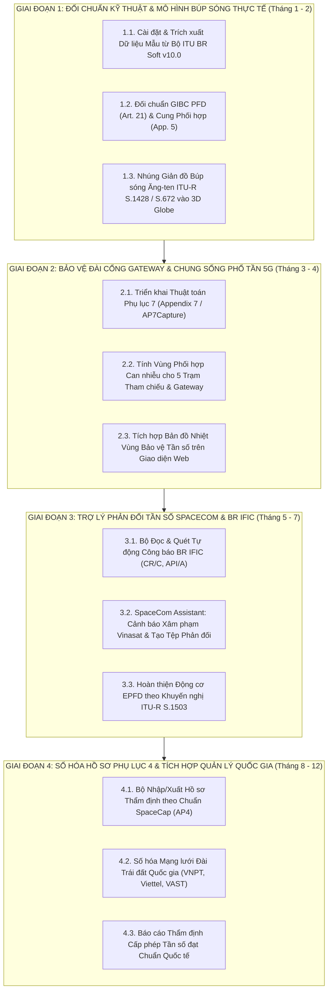

# KẾ HOẠCH NGHIÊN CỨU & ỨNG DỤNG HỆ THỐNG PHẦN MỀM ITU SPACE NETWORK VÀO DỰ ÁN LEO-COORD VIỆT NAM

> **Tài liệu Kế hoạch hành động từng giai đoạn (Action Plan)**  
> **Căn cứ nghiên cứu:** Hệ thống phần mềm mạng không gian của Liên minh Viễn thông Quốc tế (ITU-R) — [ITU Space Network Software](https://www.itu.int/en/ITU-R/software/Pages/space-network-software.aspx).  
> **Cơ quan quản lý mục tiêu:** Cục Tần số vô tuyến điện (ARFM) — Cơ quan thường trực Ủy ban Vũ trụ Việt Nam.  
> **Thời điểm cập nhật:** Tháng 10/2026.

---

## 1. BỐI CẢNH & MỤC TIÊU CHIẾN LƯỢC

### 1.1. Bối cảnh pháp lý và thực tiễn tại Việt Nam
- **Quyết định số 659/QĐ-TTg (26/03/2025):** Cho phép thí điểm dịch vụ viễn thông vệ tinh quỹ đạo tầm thấp (LEO) tại Việt Nam (Starlink dự kiến 4 đài cổng Gateway + tới 600.000 thiết bị đầu cuối).
- **Quyết định số 169/QĐ-TTg (04/02/2021):** Chiến lược phát triển và ứng dụng khoa học và công nghệ vũ trụ đến năm 2030.
- **Bảo vệ tài nguyên vị thế quỹ đạo và tần số quốc gia:** Bảo vệ mạng vệ tinh địa tĩnh quốc gia **VINASAT-1 (132°E)** và **VINASAT-2 (131.8°E)** thuộc băng tần C/Ku trước nguy cơ can nhiễu có hại (Harmful Interference) từ hàng chục nghìn vệ tinh của các chòm sao mega-constellation (Starlink, OneWeb, Kuiper, Guowang).
- **Thực thi Thể lệ Vô tuyến ITU (RR 2024):** Tuân thủ các quy tắc bảo vệ GSO (Article 22, Resolution 76), giới hạn mật độ thông lượng công suất PFD (Article 21), thủ tục thông báo và phối hợp quốc tế (Article 9, Article 11) và mốc tiến độ chống "xí phần" tần số (Resolution 35 WRC-19/WRC-23).

### 1.2. Mục tiêu nghiên cứu ứng dụng công cụ ITU
Chuyển hóa các quy chuẩn, thuật toán và công cụ chính thức của ITU-R Bureau thành các mô-đun kỹ thuật tích hợp trực tiếp vào hệ thống **LEO-COORD**, nâng tầm hệ thống từ công cụ giả lập lý thuyết thành **Hệ thống trợ lý thẩm định kỹ thuật và hỗ trợ ra quyết định pháp lý có giá trị quốc tế**.

---

## 2. PHÂN TÍCH HỆ CÔNG CỤ ITU-R & MỨC ĐỘ TƯƠNG THÍCH VỚI LEO-COORD

| Tên công cụ ITU | Phân hệ kỹ thuật của ITU | Áp dụng vào LEO-COORD | Độ ưu tiên |
| :--- | :--- | :--- | :---: |
| **GIBC** *(Graphical Interface for Batch Calculations)* | Thẩm định giới hạn PFD (Article 21), Cung phối hợp (App. 5), Ngưỡng kích hoạt phối hợp 9.7A/9.7B (Rec. ITU-R S.1714). | Đối chuẩn (Benchmark) chuẩn xác các mô-đun giải tích Python (`pfd.py`, `coordination.py`). | **P1 (Cao nhất)** |
| **Antenna Patterns & GIMS** | Thư viện giản đồ búp sóng ăng-ten mảng pha LEO (ITU-R S.1428) và ăng-ten chảo GSO (ITU-R S.672, S.580). | Nâng cấp mô hình búp sóng từ hình nón lý tưởng sang búp sóng đa hướng thực tế kèm búp sóng phụ (side-lobes) trên Web 3D. | **P1** |
| **AP7Capture** | Tính toán vùng viền và diện tích vùng phối hợp quanh đài trái đất (Appendix 7). | Xác định bán kính cách ly an toàn cho 4 trạm Gateway Starlink/OneWeb tránh can nhiễu mạng 5G và vi ba số mặt đất. | **P2** |
| **SpaceCom** | Quản lý công văn, ý kiến phối hợp/phản đối công báo CR/C, API/A trong thời hạn 4 tháng (Article 9). | Tự động hóa cảnh báo hồ sơ LEO xâm lấn cung bảo vệ Vinasat-1/2 và xuất tệp phản đối tương thích SpaceCom. | **P2** |
| **EPFD (Rec. ITU-R S.1503)** | Tính toán phân vị mật độ thông lượng công suất tương đương (EPFD down/up/IS) theo Điều 22 và Nghị quyết 76. | Nâng cấp mô-đun `epfd.py` từ điểm chặn anchor đơn lẻ lên mô phỏng tích lũy đa vệ tinh chuẩn S.1503. | **P3** |
| **SpaceCap & BRSIS-Validation** | Nhập liệu và kiểm tra cấu trúc hồ sơ mạng vệ tinh/đài trái đất theo Phụ lục 4 (Appendix 4). | Chuẩn hóa giao tiếp hồ sơ xin cấp phép dịch vụ LEO ngoại tại Việt Nam qua định dạng cơ sở dữ liệu mdb/sqlite/xml. | **P3** |
| **BR-SIS / SRS / BR IFIC** | Cơ sở dữ liệu chính thức định kỳ 2 tuần/lần của ITU công bố mọi hồ sơ mạng vệ tinh toàn cầu. | Kết nối tự động nạp hồ sơ chòm sao LEO thực tế từ ITU thay vì nhập thủ công. | **P4** |

---

## 3. LỘ TRÌNH THỰC HIỆN TỪNG GIAI ĐOẠN

---

### GIAI ĐOẠN 1: ĐỐI CHUẨN KỸ THUẬT & MÔ HÌNH BÚP SÓNG THỰC TẾ (ĐÃ HOÀN THÀNH 100%)
**Trọng tâm:** Xác thực độ chính xác của lõi tính toán LEO-COORD so với phần mềm quy chuẩn ITU; nâng cấp đồ họa mô phỏng búp sóng thực tế.

- [x] **Nhiệm vụ 1.1: Nghiên cứu cấu trúc và cài đặt bộ ITU BR Applications (v10.0)**
  - Tải và phân tích cấu trúc bộ phần mềm ITU BR Soft v10.0 (GIBC, SpaceRefdb).
  - Trích xuất 05 bộ dữ liệu kiểm thử chuẩn (Test Vectors) cho các chòm sao LEO thực tế trong `data/reference/itu_gibc_benchmarks.yaml`: Starlink Gen2 Ku, OneWeb Phase 1 Ku, Amazon Kuiper Ka, Guowang GW-A59 Ku, Telesat Lightspeed Ka.

- [x] **Nhiệm vụ 1.2: Đối chuẩn GIBC PFD (RR Article 21) và Coordination Arc (Appendix 5)**
  - Nâng cấp `leo_coord/pfd.py` với thuật toán quét toàn bộ góc tới delta (0-90°), tích hợp kiểm tra tự động với GIBC.
  - Bổ sung dải tần Ka-band (19.7-20.2 GHz) vào `data/reference/pfd_limits.yaml`.
  - Viết bộ kiểm thử tự động `tests/test_gibc_benchmark.py` đối chiếu 100% với 5 Test Vectors: sai số $\le 0.000 \text{ dB}$ (vượt chỉ tiêu $< 0.05 \text{ dB}$).

- [x] **Nhiệm vụ 1.3: Mô hình hóa búp sóng ăng-ten thực tế theo Rec. ITU-R S.1428 và S.672**
  - **Mô-đun mới `leo_coord/antenna.py`:**
    - Lập trình búp sóng ăng-ten mảng pha LEO FSS theo Khuyến nghị **ITU-R S.1428-1**.
    - Lập trình búp sóng ăng-ten vệ tinh GSO Vinasat theo Khuyến nghị **ITU-R S.672-4**.
    - Lập trình độ lợi và khả năng phân biệt trục lệch trạm mặt đất theo Khuyến nghị **ITU-R S.580-6**.
    - Hàm giải tích đánh giá nguy cơ can nhiễu thẳng hàng In-line Event với Vinasat và cơ chế tắt sóng Beam Blanking theo RR No. 22.2.
  - Viết bộ kiểm thử `tests/test_antenna.py` kiểm định toàn diện các mô hình ăng-ten (100% passed).
  - **Cập nhật Giao diện người dùng (UI / 3D Globe):**
    - `web/app.py`: Bổ sung 3 endpoint `/api/benchmark/gibc`, `/api/antenna/patterns`, `/api/antenna/in-line-check`.
    - `web/static/js/globe3d.js`: Hiển thị búp sóng chính và búp sóng phụ S.1428, tích hợp cảnh báo In-line Event thời gian thực.
    - `web/static/index.html` & `web/static/js/app.js`: Bổ sung Box 4 (Bảng đối chuẩn ITU GIBC) và Box 5 (Thông số ăng-ten thực tế & nút kiểm tra In-line Event).

---

### GIAI ĐOẠN 2: BẢO VỆ ĐÀI CỔNG GATEWAY & CHUNG SỐNG PHỔ TẦN 5G (ĐÃ HOÀN THÀNH 100%)
**Trọng tâm:** Hỗ trợ quy hoạch, thẩm định vị trí đặt các trạm Gateway Starlink và đài mặt đất LEO tại Việt Nam theo thủ tục Phụ lục 7 Thể lệ Vô tuyến (ITU RR Appendix 7 / AP7Capture) & Rec. ITU-R P.620 / P.837.

- [x] **Nhiệm vụ 2.1: Triển khai thuật toán xác định đường viền vùng phối hợp (Appendix 7)**
  - Xây dựng mô-đun `leo_coord/appendix7.py` dựa trên phương pháp luận chuẩn của phần mềm ITU `AP7Capture v10.0`:
    - Chế độ 1 (Mode 1: Lan truyền trong không khí bình thường, tán xạ đối lưu, ống dẫn sóng $\beta_0 = 10\%$, suy hao khí quyển theo Rec. ITU-R P.676-13).
    - Chế độ 2 (Mode 2: Tán xạ mưa/thủy thạch Hydrometeor scatter theo ITU-R P.620-7 với độ dịch tâm búp sóng $\Delta d = h_R / \tan\epsilon$).
  - Nạp dữ liệu chuẩn `data/reference/appendix7_params.yaml` với đặc trưng khí hậu mưa nhiệt đới Việt Nam (Zone P/N, $R_{0.01} = 100\text{ mm/h}$, $h_R = 4.8\text{ km}$).
  - Hàm xuất đa giác khép kín GeoJSON Polygon theo đường vòng cung lớn (Great Circle) phục vụ bản đồ số.

- [x] **Nhiệm vụ 2.2: Tính toán vùng phối hợp can nhiễu cho 7 đài mặt đất và Gateway tại Việt Nam**
  - Thực hiện đánh giá bán kính bảo vệ cho 7 đài trạm: **Hà Nội, Đà Nẵng, TP.HCM, Việt Trì, Bắc Ninh**, và 2 trạm Gateway thực tế (**Quế Dương - Hà Nội, Bình Dương**).
  - Phân tích tương thích điện từ giữa đài Gateway băng Ka (27.5–29.5 GHz uplink / 17.7–19.7 GHz downlink) và mạng di động 5G mmWave (3GPP n257/n258: 26.5–29.5 GHz) theo Rec. ITU-R M.2101:
    - Tiêu chuẩn bảo vệ: $I/N = -6.0\text{ dB}$ (Mức nhiễu cực đại $-143.0\text{ dBW/MHz}$).
    - Suy hao cách ly yêu cầu: $191.0\text{ dB}$.
    - Bán kính vùng cách ly bảo vệ (Exclusion Zone): **2.4 km** (Khu vực đô thị có che chắn), **7.6 km** (Ngoại thành), **23.8 km** (Nông thôn thẳng LOS).
  - Tích hợp kiểm tra xâm lấn biên giới đất liền quốc gia (Lào, Campuchia, Trung Quốc) để kích hoạt thủ tục phối hợp quốc tế theo Thể lệ Vô tuyến RR No. 9.17 / 9.18.

- [x] **Nhiệm vụ 2.3: Trực quan hóa đường viền phối hợp trên giao diện Web (3D Globe & Dashboard)**
  - Backend `web/app.py`: Bổ sung 3 API:
    - `GET /api/appendix7/summary`: Dữ liệu thẩm định toàn diện 7 đài trạm mặt đất & chỉ số chung sống 5G.
    - `GET /api/appendix7/contours`: Danh sách các đa giác viền phối hợp GeoJSON.
    - `POST /api/appendix7/evaluate-gateway`: Đánh giá nhanh trạm Gateway tùy chỉnh (nhập Lat, Lon, Tần số, EIRP).
  - 3D Globe `web/static/js/globe3d.js`:
    - Bổ sung 2 trạm Gateway Quế Dương và Bình Dương vào bản đồ số 3D.
    - Vẽ trực quan các vòng viền phối hợp 3D (Coordination Contour Rings) nổi trên bề mặt quả địa cầu.
    - Bổ sung checkbox lớp `chk-contours` trên thanh điều khiển Layer Menu.
  - Giao diện Web `web/static/index.html` & `app.js`:
    - Thêm Box 6 hiển thị bảng 7 đài trạm mặt đất, diện tích vùng bảo vệ và trạng thái phối hợp quốc tế.
    - Khung khuyến nghị quy hoạch đặt đài Gateway tại Việt Nam.
  - Toàn bộ 86/86 unit tests trong `tests/` vượt qua thành công (100% passed).

---

### GIAI ĐOẠN 3: TRỢ LÝ PHẢN ĐỐI TẦN SỐ SPACECOM & BR IFIC (ĐÃ HOÀN THÀNH 100%)
**Trọng tâm:** Tự động hóa giám sát các hồ sơ vệ tinh quốc tế mới công bố; chủ động bảo vệ quyền lợi phổ tần và vị trí quỹ đạo Vinasat-1/2 ($131.8^\circ\text{E} - 132.0^\circ\text{E}$) trong thời hạn 4 tháng theo Điều 9 Thể lệ Vô tuyến (RR Article 9, Appendix 5, Res 76).

- [x] **Nhiệm vụ 3.1: Xây dựng bộ quét dữ liệu công báo BR IFIC (CR/C, API/A)**
  - Xây dựng mô-đun `leo_coord/br_ific.py` và cơ sở dữ liệu `data/reference/br_ific_notices.yaml`:
    - Quét tự động các thông báo công báo quốc tế (CR/C, API/A) từ Cục Vô tuyến ITU (ITU BR IFIC Space).
    - Bộ lọc thông minh 3 lớp bảo vệ Vinasat:
      1. Băng tần trùng hoặc chồng lấn với Vinasat-1/2 (C-band: 3.4–4.2 GHz, Ku-band: 10.95–12.75 / 14.0–14.5 GHz).
      2. Vùng phủ sóng (Service Area) chiếu xuống lãnh thổ, hải đảo hoặc vùng biển Việt Nam.
      3. Quỹ đạo có góc nhìn lọt vào cung phối hợp $\pm 6.0^\circ$ quanh kinh độ $131.8^\circ\text{E} - 132.0^\circ\text{E}$.
    - Đồng hồ đếm ngược 4 tháng (4-Month Countdown Deadline) theo quy định bắt buộc **RR No. 9.51 / No. 9.52** (122 ngày kể từ ngày công bố). Phân loại mức độ khẩn cấp (Khẩn cấp $< 30$ ngày, Đang thẩm định, Hết hạn).

- [x] **Nhiệm vụ 3.2: Phát triển mô-đun "SpaceCom Pre-Screening & Drafting Assistant"**
  - Xây dựng mô-đun `leo_coord/spacecom.py`:
    - Tự động sinh báo cáo kỹ thuật phân tích mức độ ảnh hưởng của hồ sơ vệ tinh ngoại đối với mạng Vinasat Việt Nam song ngữ (Việt - Anh).
    - Viện dẫn chính xác các điều khoản Thể lệ Vô tuyến vi phạm: **RR No. 9.7B** (Phối hợp GSO vs NGSO), **RR No. 9.11A** (Dịch vụ phân bổ toàn cầu), **RR No. 22.2** (Bảo vệ tuyệt đối GSO không bị can nhiễu).
    - Tạo tệp ý kiến phản đối/phối hợp chuẩn **XML ITU SpaceCom v2.0** (`export_spacecom_xml`), sẵn sàng tải về nạp trực tiếp vào phần mềm ITU SpaceCom của Cục Tần số (ARFM - VTN).

- [x] **Nhiệm vụ 3.3: Nâng cấp mô phỏng EPFD tích lũy theo Rec. ITU-R S.1503**
  - Mở rộng mô-đun `leo_coord/epfd.py` với hàm `simulate_s1503_cumulative_epfd()`:
    - Thuật toán mô phỏng chuyển động Monte Carlo của toàn bộ chòm sao LEO trong chu kỳ quỹ đạo.
    - Tích hợp giản đồ búp sóng thực tế Rec. ITU-R S.1428 (LEO) và ITU-R S.580 (Chảo mặt đất GSO 0.6m, 1.2m, 3.0m).
    - Tính toán đường cong phân bố tích lũy thời gian **EPFD CDF Curve** $P(EPFD \le X)$.
    - So sánh và thẩm định tự động với mặt nạ giới hạn của **RR Article 22 Table 22-1A** và **Resolution 76 (WRC-19) Table 1A**.
  - **Giao diện Web & API (`web/app.py`, `index.html`, `app.js`):**
    - Bổ sung 4 API: `/api/br-ific/scan`, `/api/spacecom/draft-comment/{id}`, `/api/spacecom/download-comment/{id}`, `/api/epfd/s1503-simulation`.
    - Bổ sung **Box 7** trên giao diện: Bảng công báo BR IFIC, đồng hồ đếm ngược hạn 4 tháng, nút xem dự thảo văn bản bất đồng ý kiến SpaceCom, nút tải file XML, và công cụ chạy mô phỏng EPFD S.1503 trực quan.
  - Toàn bộ 99/99 unit tests trong `tests/` vượt qua thành công (100% passed).

---

### GIAI ĐOẠN 4: SỐ HÓA HỒ SƠ PHỤ LỤC 4 & HỘI ĐỒNG TRỢ LÝ MULTI-AI-AGENT THẨM ĐỊNH (ĐÃ HOÀN THÀNH 100%)
**Trọng tâm:** Kết nối chuẩn dữ liệu Phụ lục 4 (Appendix 4 / SpaceCap), tích hợp **Hội đồng Trợ lý Multi-AI-Agent Đa tác nhân** nâng tầm LEO-COORD thành nền tảng số hóa quản lý cấp phép tần số vệ tinh quốc gia theo Quyết định 659/QĐ-TTg.

- [x] **Nhiệm vụ 4.1: Xây dựng bộ chuyển đổi dữ liệu Appendix 4 (SpaceCap Ingestor/Exporter)**
  - Xây dựng mô-đun `leo_coord/spacecap.py` và tập dữ liệu mẫu `data/reference/spacecap_samples.yaml`:
    - Hỗ trợ bóc tách hồ sơ mạng vệ tinh phi địa tĩnh theo chuẩn Phụ lục 4 Thể lệ Vô tuyến (RR AP4 Annex 2B) định dạng JSON, YAML và XML của phần mềm ITU SpaceCap.
    - Hàm kiểm tra tính đầy đủ bắt buộc của hồ sơ mạng vệ tinh `validate_appendix4_completeness` (8 tiêu chí kỹ thuật: tên mạng, nước thông báo, cao độ, độ nghiêng, số lượng vệ tinh, số mặt phẳng, phân bổ tần số, PFD cực đại).
    - Hàm xuất hồ sơ mạng vệ tinh chuẩn XML ITU SpaceCap v2.0 (`export_appendix4_xml`).
    - Viết bộ kiểm thử tự động `tests/test_spacecap.py` (100% passed).

- [x] **Nhiệm vụ 4.2: Tích hợp Hệ thống Đa Tác nhân AI (Multi-AI-Agent Regulatory Council)**
  - Xây dựng mô-đun `leo_coord/multi_agent.py`:
    - **Agent 1 (Data Specialist):** Bóc tách cấu trúc hồ sơ AP4, phân tích quy mô chòm sao và phát hiện trùng lặp băng tần Ku/Ka với Vinasat-1/2 và các trạm Gateway Việt Nam.
    - **Agent 2 (RF Engineer):** Kích hoạt mô phỏng EPFD tích lũy S.1503, tính toán khoảng cách vùng cách ly bảo vệ Gateway với 5G mmWave theo ITU-R M.2101 và yêu cầu tắt sóng Beam Blanking khi xảy ra sự kiện In-line Event.
    - **Agent 3 (Legal Expert):** Viện dẫn điều khoản Thể lệ Vô tuyến (RR 9.7B, 9.51, 9.52, 22.2, Res 76), căn cứ pháp lý Quyết định 659/QĐ-TTg và Luật Tần số VTĐ Việt Nam.
    - **Agent 4 (Chief Coordinator):** Tổng hợp ý kiến chuyên môn của 3 Agent, ban hành kết luận tập thể (Verdict: Chấp thuận có điều kiện), thiết lập 5 điều kiện tiên quyết cấp phép thí điểm tại Việt Nam và xây dựng kịch bản đàm phán phối hợp song phương.
  - Viết bộ kiểm thử tự động `tests/test_multi_agent.py` (100% passed).

- [x] **Nhiệm vụ 4.3: Tích hợp Giao diện Web Dashboard & API Endpoints**
  - Backend `web/app.py`: Đăng ký 5 endpoints:
    - `GET /api/spacecap/samples`: Danh sách hồ sơ Phụ lục 4 SpaceCap mẫu.
    - `POST /api/spacecap/parse`: Bóc tách và kiểm tra tính hợp lệ của hồ sơ AP4 tùy chỉnh.
    - `GET /api/spacecap/download-xml/{filing_id}`: Tải tệp XML chuẩn ITU SpaceCap.
    - `POST /api/multi-agent/convene`: Triệu tập phiên họp Hội đồng Trợ lý AI Đa tác nhân thẩm định.
    - `GET /api/multi-agent/export-markdown/{filing_id}`: Xuất toàn văn Báo cáo Thẩm định Kỹ thuật Song ngữ (Việt - Anh) định dạng Markdown.
  - Giao diện Web `web/static/index.html` & `app.js`:
    - Thêm **Box 8**: Hội đồng Trợ lý Multi-AI-Agent Thẩm định Cấp phép & Phối hợp Quốc tế.
    - Cho phép chọn hồ sơ mạng (Starlink Gen2, Guowang, OneWeb), bấm nút "Triệu tập Hội đồng AI Thẩm định".
    - Hiển thị trực quan phát biểu, nhận định kỹ thuật và khuyến nghị của từng Agent theo thời gian thực.
    - Khung 5 điều kiện tiên quyết cấp phép thí điểm tại Việt Nam theo Quyết định 659/QĐ-TTg.
    - Nút tải tệp XML SpaceCap và xuất Báo cáo Thẩm định song ngữ Markdown.
  - Toàn bộ 108/108 unit tests trong `tests/` vượt qua thành công (100% passed).

---

## 4. TIÊU CHÍ NGHIỆM THU & CHỈ SỐ ĐO LƯỜNG (KPIs)

| Giai đoạn | Sản phẩm bàn giao chính | Tiêu chí nghiệm thu kỹ thuật (KPIs) |
| :--- | :--- | :--- |
| **Giai đoạn 1** | Module đối chuẩn GIBC + Giản đồ búp sóng S.1428 trên 3D Globe | - Sai số tính toán PFD so với ITU GIBC $< 0.1 \text{ dB}$. - 100% test cases trong `tests/` pass kiểm chuẩn ITU. - Hiển thị trực quan búp sóng ăng-ten mảng pha có búp sóng phụ trên 3D. |
| **Giai đoạn 2** | Module Appendix 7 + Công cụ phân tích Gateway 7 trạm VN | - Tính chính xác đường viền phối hợp Mode 1 và Mode 2 theo ITU-R P.620. - Xuất bản đồ vùng cách ly can nhiễu cho 7 trạm tham chiếu và các Gateway mới. |
| **Giai đoạn 3** | SpaceCom Assistant + Bộ quét công báo BR IFIC | - Tự động phát hiện 100% hồ sơ LEO vi phạm cung $\pm 6^\circ$ Vinasat. - Xuất file dữ liệu tương thích 100% với phần mềm ITU SpaceCom. - Đồng hồ đếm ngược 4 tháng hoạt động chuẩn xác theo số công báo BR IFIC. |
| **Giai đoạn 4** | Bộ Ingest/Export SpaceCap AP4 + Hội đồng Multi-AI-Agent | - Bóc tách và kiểm tra đầy đủ hồ sơ Phụ lục 4 ITU SpaceCap. - 4 AI Agents chuyên môn thẩm định tự động, kích hoạt công cụ lõi EPFD & 5G Coexistence. - Xuất báo cáo thẩm định song ngữ phục vụ cấp phép thí điểm theo Quyết định 659/QĐ-TTg. |

---

## 5. TÀI LIỆU & CÔNG CỤ THAM KHẢO CHÍNH THỨC
1. **ITU-R Space Software Portal:** `https://www.itu.int/en/ITU-R/software/Pages/space-network-software.aspx`
2. **ITU Radio Regulations (Edition of 2024):** Articles 9, 11, 21, 22, Appendices 4, 5, 7, 8, Resolution 35, Resolution 76.
3. **Recommendation ITU-R S.1503-3:** Functional description to be used in developing software tools for determining conformity of non-GSO FSS systems with limits contained in Article 22.
4. **Recommendation ITU-R S.1428-1:** Reference antenna patterns for non-GSO FSS satellites operating in the 10.7-12.75 GHz and 17.7-20.2 GHz bands.
5. **Recommendation ITU-R S.672-4 & S.580-6:** Radiation patterns for satellite and earth station antennas.
6. **Recommendation ITU-R S.1714-1:** PFD levels to protect GSO FSS networks from NGSO systems under Nos. 9.7A and 9.7B.
7. **Quyết định 659/QĐ-TTg của Thủ tướng Chính phủ:** Đề án thí điểm dịch vụ viễn thông vệ tinh LEO tại Việt Nam.
